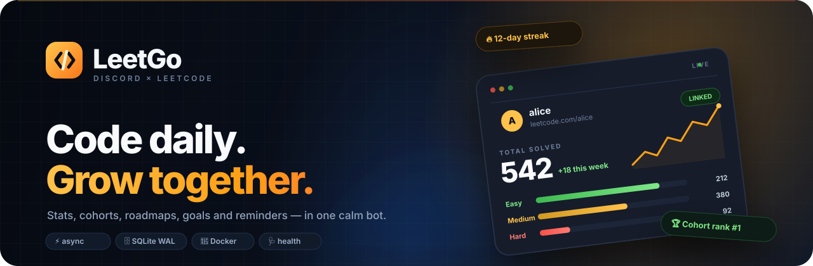
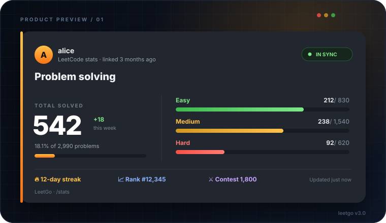
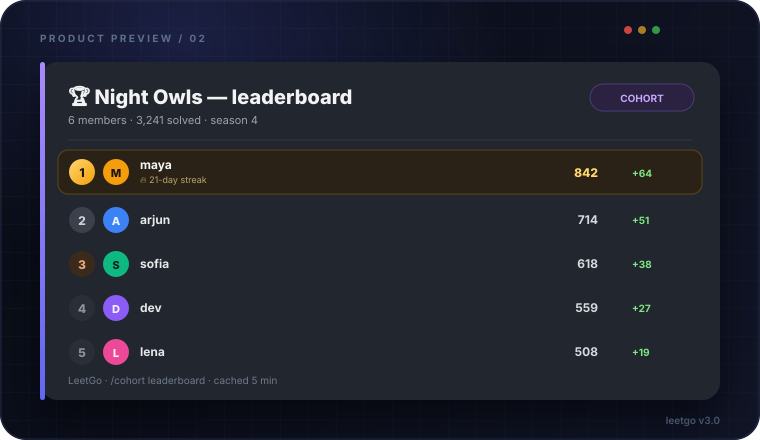
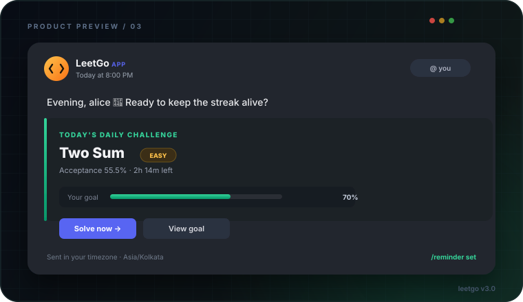
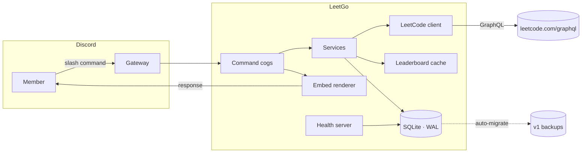
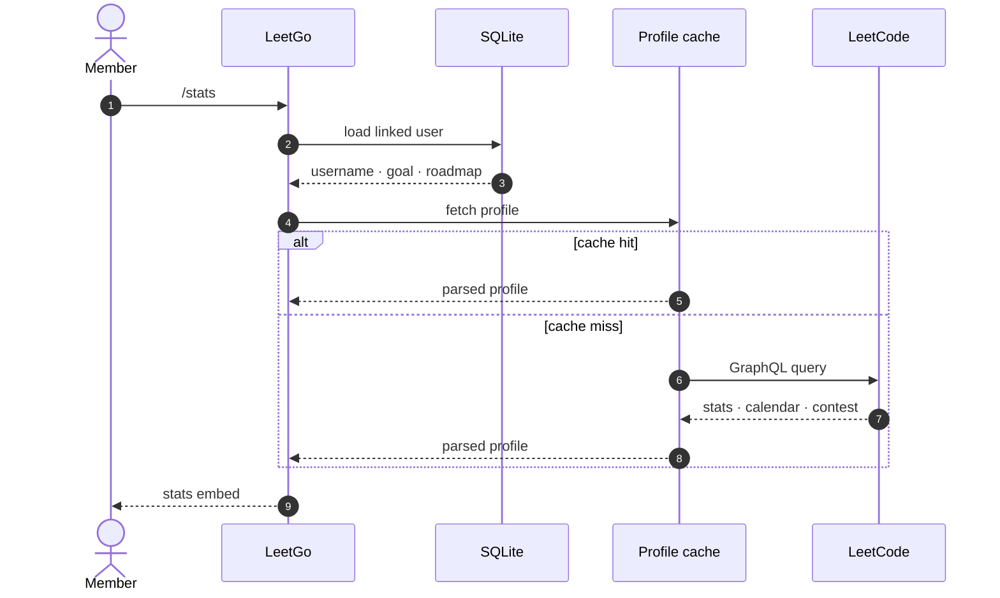

<div align="center">
  
  <h1>LeetGo</h1>
  <p><strong>The LeetCode companion that turns solo grinding into a team sport.</strong></p>
  <p>Track stats, run study cohorts, follow roadmaps, hit goals, and keep a streak alive —<br />right inside Discord, with slash commands only.</p>
</div>

<p align="center">
  <a href="https://github.com/Abhinav-Prabhakar/LeetGo/actions/workflows/ci.yml"></a>
  
  
  
  
  
</p>

<p align="center">
  
  
  
  
  
  
  
  
  
  
  
</p>

<p align="center">
  
</p>

<p align="center">
  <a href="#why-leetgo">Why LeetGo</a> ·
  <a href="#preview">Preview</a> ·
  <a href="#command-deck">Commands</a> ·
  <a href="#quick-start">Quick start</a> ·
  <a href="#configuration">Configuration</a> ·
  <a href="#architecture">Architecture</a> ·
  <a href="#deployment">Deployment</a> ·
  <a href="#development">Development</a> ·
  <a href="#troubleshooting">Troubleshooting</a>
</p>

---

## Why LeetGo

LeetCode is great at telling you what you solved. It is less great at keeping a group
accountable. LeetGo closes that gap with a small, fast bot that lives where your study
group already talks.

| | Feature | What it actually does |
|:--:|:--|:--|
| 📊 | **Stats that read well** | Solved totals by difficulty, acceptance, streak, contest rating, recent accepted runs, and goal pace in one clean embed. |
| 🏘️ | **Cohorts, not spreadsheets** | `/cohort create` provisions a Discord channel, a roster, a private leaderboard, and an ownership model with transfer and safe deletion. |
| 🗺️ | **Roadmaps with memory** | Four curated paths — Beginner, Intermediate, Advanced and Interview Prep — with per-topic progress saved to SQLite. |
| 🎯 | **Goals with honest pacing** | Set a target and timeframe. LeetGo records your baseline and tells you whether you are ahead, behind, or done — not just a raw count. |
| ⏰ | **Reminders in *your* timezone** | Pick an IANA timezone and a local time. A resilient scheduler DMs you once per day with the daily challenge and your goal context. |
| 🛡️ | **Production manners** | Async I/O, retries with backoff, per-user cache locks, SQLite WAL, auto-migration, cooldowns, graceful shutdown, health checks and Prometheus metrics. |

> **No API keys. No LeetCode password. No scraping.** LeetGo talks to LeetCode's public
> GraphQL endpoint and stores only the Discord ID, LeetCode username and the preferences
> you set.

---

## Preview

<p align="center">
  
</p>

<p align="center"><em><code>/stats</code> — one card, the whole picture.</em></p>

<p align="center">
  
</p>

<p align="center"><em><code>/cohort leaderboard</code> — friendly competition, cached for five minutes.</em></p>

<p align="center">
  
</p>

<p align="center"><em><code>/reminder set</code> — a nudge at 8pm, not a cron job you have to babysit.</em></p>

---

## Command deck

Every command is a slash command. LeetGo does not register a message prefix.

### Profile & stats

| Command | Description |
|:--|:--|
| `/set-username <username>` | Link or update your LeetCode username. Claims a legacy account if the username matches. |
| `/profile [member]` | Show a member's linked username, roadmap, goal and reminder status. |
| `/stats [member]` | Full LeetCode card: difficulty split, streak, rank, contest rating, recent solves and goal pace. |
| `/daily` | Today's LeetCode challenge with acceptance rate and a direct link. |
| `/compare <first> <second>` | Side-by-side stats and a verdict for two linked members. |
| `/leaderboard [cohort\|server]` | Rank linked members by total solved. |
| `/unlink` | Delete your LeetGo data. Blocked while you host a cohort. |

### Cohorts

| Command | Description |
|:--|:--|
| `/cohort create <name>` | Create a cohort and its Discord channel under the configured category. |
| `/cohort join [name]` | Join by name or pick from a dropdown. |
| `/cohort leave` | Leave your current cohort. Hosts must transfer or delete first. |
| `/cohort info [name]` | Host, member count, roster and channel. Defaults to your cohort. |
| `/cohort list` | Every cohort in the server. |
| `/cohort leaderboard [name]` | Rank cohort members by solved problems. |
| `/cohort transfer <member> [name]` | Hand ownership to another member of the cohort. |
| `/cohort delete [name]` | Delete the cohort and its channel after a confirmation. Host only. |

### Growth

| Command | Description |
|:--|:--|
| `/roadmap` | Choose or review one of four learning paths. |
| `/roadmap-progress` | Tick topics off your current path with a multi-select menu. |
| `/goal set <questions> <months>` | Commit to a target. The current solved count becomes your baseline. |
| `/goal view` | Progress, expected pace, delta and days remaining. |
| `/goal clear` | Remove your goal. |

### Reminders

| Command | Description |
|:--|:--|
| `/reminder set <hour> <minute> [timezone]` | Daily DM reminder at a local time. Timezone autocomplete included. |
| `/reminder view` | Your schedule, local time and next delivery. |
| `/reminder remove` | Stop reminders. |
| `/reminder test` | Send yourself a sample reminder immediately. |

### Utility

| Command | Description |
|:--|:--|
| `/help` | The full command guide, grouped by area. |
| `/ping` | Gateway, database and uptime latency. |
| `/about` | Version, stack, uptime and live counts. |

> **Permissions:** View Channels, Send Messages, Embed Links, Read Message History, and
> Manage Channels (for cohort creation and cleanup). Server Members Intent is required.

---

## Quick start

### Option A — Docker (recommended)

```bash
git clone https://github.com/Abhinav-Prabhakar/LeetGo.git
cd LeetGo
cp .env.example .env
# edit .env and set BOT_TOKEN
docker compose up -d --build
docker compose logs -f leetgo
```

The image runs as an unprivileged `leetgo` user, stores the database in the
`leetgo-data` volume and exposes the health server on port `8080`.

### Option B — Local Python

Requires **Python 3.11+**.

```bash
git clone https://github.com/Abhinav-Prabhakar/LeetGo.git
cd LeetGo
python -m venv .venv
source .venv/bin/activate        # Windows: .venv\Scripts\activate
pip install -e .
cp .env.example .env
# edit .env and set BOT_TOKEN
python -m leetgo
```

### Create the Discord application

1. Open the [Discord Developer Portal](https://discord.com/developers/applications) and
   create an application.
2. Add a **Bot**, copy the token into `BOT_TOKEN`, and enable **Server Members Intent**
   under *Bot → Privileged Gateway Intents*.
3. Invite the bot with the `bot` and `applications.commands` scopes:

   ```
   https://discord.com/api/oauth2/authorize?client_id=YOUR_CLIENT_ID&permissions=85008&scope=bot%20applications.commands
   ```

   Permission integer `85008` = View Channels + Send Messages + Manage Channels +
   Embed Links + Read Message History. Add more only if your server policy requires it.

4. Run the bot and try `/help` in your server.

> **Development tip:** set `GUILD_ID` to your server ID. Slash commands then sync
> instantly to that guild instead of waiting for Discord's global propagation.

---

## Configuration

All settings are environment variables and can live in `.env`. Empty optional values are
treated as unset.

| Variable | Default | Description |
|:--|:--|:--|
| `BOT_TOKEN` | — | **Required.** Discord bot token. |
| `GUILD_ID` | unset | Sync commands to one guild immediately. Development only. |
| `COHORT_CATEGORY` | `Cohorts` | Category where cohort channels are created. |
| `DATABASE_PATH` | `data/leetgo.db` | SQLite database location. |
| `DEFAULT_TIMEZONE` | `UTC` | Fallback IANA timezone for new users. |
| `LEETCODE_CACHE_TTL` | `300` | Profile cache lifetime in seconds (`0` disables caching). |
| `LEETCODE_TIMEOUT` | `15` | GraphQL request timeout in seconds. |
| `LEETCODE_RETRIES` | `3` | Attempts per request before giving up. |
| `MAX_COHORTS_PER_GUILD` | `50` | Safety limit on cohorts per server. |
| `MAX_LEADERBOARD_USERS` | `50` | Maximum members ranked in one leaderboard. |
| `REMINDER_POLL_SECONDS` | `30` | How often the reminder scheduler wakes up. |
| `LOG_LEVEL` | `INFO` | `DEBUG`, `INFO`, `WARNING`, `ERROR` or `CRITICAL`. |
| `LOG_FILE` | `logs/leetgo.log` | Rotating log file. Set empty to log to stdout only. |
| `LOG_JSON` | `false` | Emit structured JSON logs for aggregators. |
| `HEALTH_HOST` | `0.0.0.0` | Bind address for the health server. |
| `HEALTH_PORT` | `0` | Port for `/healthz` and `/metrics`. `0` disables the server. |
| `ENVIRONMENT` | `production` | `development` or `production`. |

---

## Architecture



A `/stats` request, end to end:



### Reliability decisions

- **Direct GraphQL, no dead middleman.** The old public stats API is gone. LeetGo queries
  `leetcode.com/graphql` directly with a browser-like `Referer`, an async session, request
  coalescing per username, a five-minute cache, and retry/backoff on `5xx`, timeouts and
  `429` responses.
- **Identity is a Discord snowflake.** The database keys users by Discord ID. A nullable
  `user_id` exists only so legacy v1 rows can be claimed safely.
- **SQLite is enough.** WAL mode, foreign keys, indexes and short transactions keep a
  community bot fast without asking you to run Postgres.
- **Failures are legible.** Expected errors (bad username, rate limit, missing permissions)
  get friendly embeds. Unexpected errors get a reference ID that matches the server log.
- **Shutdown is graceful.** SIGINT/SIGTERM stops the health server, closes the HTTP session,
  closes SQLite, then disconnects the gateway.

### Health & metrics

Set `HEALTH_PORT` (the Docker image sets `8080`) to expose:

| Endpoint | Response |
|:--|:--|
| `GET /` | Service name, version and endpoint list. |
| `GET /healthz` | JSON status, database check, uptime, gateway latency and guild count. Returns `503` if SQLite is unhealthy. |
| `GET /metrics` | Prometheus gauges: uptime, guilds, linked users, cohorts and active reminders. |

```bash
curl -s localhost:8080/healthz | jq
curl -s localhost:8080/metrics
```

---

## Deployment

The provided image is intentionally boring: one process, one SQLite file, no external
queue. Run one replica per database.

```bash
docker compose up -d --build
docker compose ps
docker compose logs -f leetgo
```

`docker-compose.yml` already sets a restart policy, graceful stop window, persistent
volumes, and the health check inherited from the image. Point your reverse proxy or
uptime monitor at `/healthz` if you want external checks.

<details>
<summary><strong>systemd unit for a bare-metal install</strong></summary>

```ini
[Unit]
Description=LeetGo Discord bot
After=network-online.target
Wants=network-online.target

[Service]
Type=simple
User=leetgo
Group=leetgo
WorkingDirectory=/opt/LeetGo
EnvironmentFile=/opt/LeetGo/.env
ExecStart=/opt/LeetGo/.venv/bin/python -m leetgo
Restart=on-failure
RestartSec=5
TimeoutStopSec=30
NoNewPrivileges=true
PrivateTmp=true
ProtectSystem=strict
ReadWritePaths=/opt/LeetGo/data /opt/LeetGo/logs

[Install]
WantedBy=multi-user.target
```

```bash
sudo systemctl daemon-reload
sudo systemctl enable --now leetgo
sudo journalctl -u leetgo -f
```
</details>

### Backups

Stop the bot or use SQLite's online backup command; copying only the main file while WAL
is active can miss recent writes.

```bash
sqlite3 data/leetgo.db ".backup 'data/leetgo-$(date +%F).db'"
```

Keep the last few backups somewhere other than the container volume.

---

## Data & upgrades

LeetGo stores everything in one SQLite file (`data/leetgo.db` by default).

**Upgrading from v2?** If a v2-era `storage.db` is present in the working directory or
`data/`, LeetGo imports it into `data/leetgo.db` automatically on first start. You can also
copy it there manually. LeetGo detects the v1 schema and:

1. snapshots the old tables as `users_v1_backup` and `cohorts_v1_backup`,
2. migrates cohorts, goals and reminder settings,
3. leaves legacy users unclaimed (`user_id = NULL`) until they run `/set-username` with
   their existing LeetCode username.

The migration is idempotent. Back up the file before upgrading anyway:

```bash
cp data/leetgo.db data/leetgo.db.bak
```

Cohort deletion removes memberships and the Discord channel. `/unlink` cascades through
the user's reminders and membership, but refuses to run while the user hosts a cohort.

---

## Development

```bash
make dev        # venv + editable install + dev tools + pre-commit hooks
make check      # ruff lint + format check + mypy + pytest
make coverage   # pytest with a terminal coverage report
make run        # python -m leetgo
```

Prefer raw commands?

```bash
ruff check .
ruff format --check .
mypy leetgo
pytest
```

### Project layout

<details>
<summary>Expand the tree</summary>

```text
LeetGo/
├── leetgo/
│   ├── __main__.py        # CLI entry point, signal handling
│   ├── bot.py             # client lifecycle, cogs, error mapping
│   ├── config.py          # pydantic-settings configuration
│   ├── db.py              # async SQLite, schema and v1 migration
│   ├── leetcode.py        # GraphQL client, parser, cache, retries
│   ├── models.py          # UserRecord, CohortRecord, goal math
│   ├── embeds.py          # all Discord card rendering
│   ├── leaderboard.py     # cached cohort/server ranking
│   ├── health.py          # /healthz and /metrics
│   ├── timezones.py       # IANA validation and reminder windows
│   └── cogs/              # profile, stats, cohorts, roadmap, goals, reminders, meta
├── tests/                 # unit tests for parsing, storage, scheduling and config
├── docs/assets/           # hand-built SVG banners and product previews
├── Dockerfile
├── docker-compose.yml
└── pyproject.toml
```

</details>

### Quality gates

| Gate | Tool | What it protects |
|:--|:--|:--|
| Lint | Ruff | Imports, bugs, async pitfalls, modern syntax |
| Format | Ruff formatter | Consistent 100-column style |
| Types | mypy | Typed boundaries across cogs, DB and API |
| Tests | pytest + pytest-asyncio | Parsers, migrations, caches, reminders, goals |
| Build | Docker + GitHub Actions | Reproducible image and Python 3.11–3.13 compatibility |

The test suite uses isolated temporary databases and fake HTTP responses, so it never
touches your real data or rate-limits LeetCode.

---

## Troubleshooting

<details>
<summary><strong>Slash commands do not appear</strong></summary>

Global commands can take up to an hour to propagate. Set `GUILD_ID` for instant per-guild
sync, restart once, and make sure the bot was invited with the `applications.commands`
scope. Re-inviting with the URL above fixes a missing scope.
</details>

<details>
<summary><strong>Reminders never arrive</strong></summary>

The user must share a server with the bot and allow direct messages. Run
`/reminder test` to check delivery. The scheduler polls every `REMINDER_POLL_SECONDS` and
allows a three-minute delivery window, so short restarts do not drop a reminder.
</details>

<details>
<summary><strong>Cohort creation fails</strong></summary>

LeetGo needs **Manage Channels** and must be below the category's permission overwrites.
If it cannot create the `Cohorts` category, create one manually or change
`COHORT_CATEGORY`. Channel names are slugified; a name collision returns a clear error.
</details>

<details>
<summary><strong>LeetCode says the user does not exist</strong></summary>

Usernames are case-insensitive on LeetCode but must be the username, not the display
name. Run `/set-username` with the exact handle from your profile URL.
</details>

<details>
<summary><strong>A command returned a reference ID</strong></summary>

Search `logs/leetgo.log` for that ID. The log entry includes the guild, user, command and
stack trace with secrets removed. Please attach it to a bug report — never paste your bot
token.
</details>

---

## Roadmap

- [x] v3.0 — async rewrite, direct GraphQL, cohorts, goals, roadmaps, reminders
- [x] Docker image, Compose stack, health and metrics endpoints
- [x] Automatic v1 → v2 database migration with backups
- [x] Test suite, CI across Python 3.11–3.13, pre-commit
- [ ] Weekly cohort recaps and streak celebrations
- [ ] Additional roadmap tracks (system design, SQL, contests)
- [ ] Optional web dashboard for server admins
- [ ] More granular reminder schedules (weekdays only)

Have a better idea? [Open a feature request](https://github.com/Abhinav-Prabhakar/LeetGo/issues/new?template=feature_request.yml).

---

## Contributing

Contributions are welcome — bug reports, docs, new roadmap topics and careful refactors
alike.

```bash
git checkout -b feature/your-idea
make dev
make check
git commit -m "feat: describe the change"
```

Please read [CONTRIBUTING.md](CONTRIBUTING.md) and our
[Code of Conduct](CODE_OF_CONDUCT.md). For security issues, use
[private vulnerability reporting](SECURITY.md) instead of a public issue.

If LeetGo helps your grind, a ⭐ on the repo is the nicest tip.

---

## License

Released under the [MIT License](LICENSE).

<p align="center">
  <sub>Built with discord.py, aiohttp, aiosqlite and a stubborn belief that consistency beats intensity.</sub><br />
  <sub>LeetGo is an independent project and is not affiliated with LeetCode or Discord.</sub>
</p>
